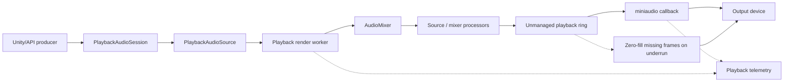

# Playback

EasyMic playback uses a miniaudio output device, a managed mixer, and a playback render worker. The output callback consumes pre-rendered samples from an unmanaged ring.

## Playback Flow



```text
Unity/API source
  -> PlaybackAudioSession / PlaybackAudioSource
  -> playback render worker
  -> AudioMixer / source processors
  -> unmanaged playback ring
  -> miniaudio callback
  -> output device
```

The miniaudio callback does not mix sources or run processors. It reads from the playback ring and zero-fills missing frames.

## Play an AudioClip

```csharp
PlaybackHandle handle = AudioPlayback.PlayClip(
    clip,
    loop: false,
    volume: 1f,
    autoDisposeOnComplete: true,
    latencyProfile: EasyMicLatencyProfile.LowLatency);
```

Use `PlaybackHandle` to pause, resume, stop, change volume, or dispose.

## Output Devices

```csharp
PlaybackOutputDevice[] devices = AudioPlayback.GetOutputDevices();
AudioPlayback.SetOutputDevice(devices[1].Id); // Set before starting playback.
```

An empty ID selects the system default. On mobile, independent playback uses the media stream/session so hardware volume controls affect it; iOS defaults to the external speaker and follows the route selected by iOS. Use the iOS system audio route picker for Bluetooth or AirPlay selection. Device IDs are opaque and may change when the available endpoints change.

## Stream Interleaved PCM

```csharp
PlaybackHandle stream = AudioPlayback.CreateStream(1f, EasyMicLatencyProfile.Balanced);

EasyMicEnqueueResult result = stream.TryEnqueue(
    samples,
    count: samples.Length,
    channels: 1,
    sampleRate: 24000);

if (!result.Success)
{
    Debug.LogWarning($"Could not enqueue all samples: {result.Status}");
}

stream.CompleteStream();
```

`TryEnqueue` reports partial writes, full queues, disposed handles, and invalid formats. Streaming producers should watch `BufferedSeconds` and avoid pushing unbounded audio.

## Component Playback

`PlaybackAudioSourceBehaviour` wraps `PlaybackAudioSession` for scene use.

Choose a speaker in the component Inspector's **Output Device** dropdown. **Refresh** reloads the available endpoints:

- **Use Audio System Output** (default) preserves the global output selected through `AudioPlayback.SetOutputDevice(...)` or another component.
- **System Default** explicitly selects the system default output.
- A named device stores its endpoint ID in the scene or prefab and applies it before creating the playback session.

All EasyMic sources share one output device. Select it before the playback system starts. Pausing or stopping a component does not stop the global `AudioSystem`, and changing to a different endpoint while it is running is rejected. Multiple components may select the same endpoint; conflicting selections fail without interrupting existing playback. The component runs early (default execution order -100), but scripts that start playback even earlier must configure the global output first. Unavailable saved endpoints are retained and shown with a warning; they are not silently replaced with the system default. On iOS, output routes remain managed by the system.

Configure an inactive component before enabling it. Setting `OutputDeviceId` also enables `OverrideOutputDevice`:

```csharp
// The playback GameObject must be inactive at this point.
playback.OutputDeviceId = selectedDevice.Id; // Empty selects the system default.
playback.gameObject.SetActive(true);
```

Set `OverrideOutputDevice` to `false` to inherit the global output again. This leaves the current global device unchanged.

Useful members:

- `PlayClip(AudioClip clip, bool loop = true)`;
- `Play()`, `Resume()`, `Pause()`, `Stop()`;
- `TryEnqueue(...)`;
- `CompleteStream()`;
- `BufferedSeconds`;
- `ProgressNormalized`;
- `OnPlaybackCompleted`;
- `OnAudioPlaybackRead`.

`OnAudioPlaybackRead` is not a Unity main-thread event. Treat it as audio-thread/transport-sensitive data and keep handlers small.

## Watermark Scheduling

`PlaybackRenderTransport` keeps a target amount of rendered audio in the playback ring:

- below the low watermark, it renders until the target buffer is reached;
- below the high watermark, it opportunistically renders one block;
- when the ring is sufficiently full, it waits briefly.

This keeps mixing and processor work off the device callback while avoiding unnecessary buffering.

## Underruns and Zero Fill

If the output callback asks for more frames than the playback ring contains, EasyMic clears the missing output samples. This keeps the device running and increments:

- `TransportUnderruns`;
- `ZeroFilledFrames`;
- queue depth telemetry.

Frequent underruns usually mean:

- the latency profile is too aggressive;
- the playback render worker is blocked;
- source/mixer processors are doing too much work;
- producers are not enqueueing streamed audio early enough;
- scene loading or GC is starving worker scheduling.

## Playback Diagnostics

```csharp
var system = AudioSystem.Instance;
var t = system.Telemetry;

Debug.Log(
    $"running={system.IsRunning}, underruns={t.TransportUnderruns}, " +
    $"zeroFill={t.ZeroFilledFrames}, queue={t.LastQueueDepthSamples}");
```

Use `AudioSystem.Instance.PipelineSnapshot` for visualizer-style topology and `AudioSystem.Instance.LatencyStats` for queue depth in milliseconds.
